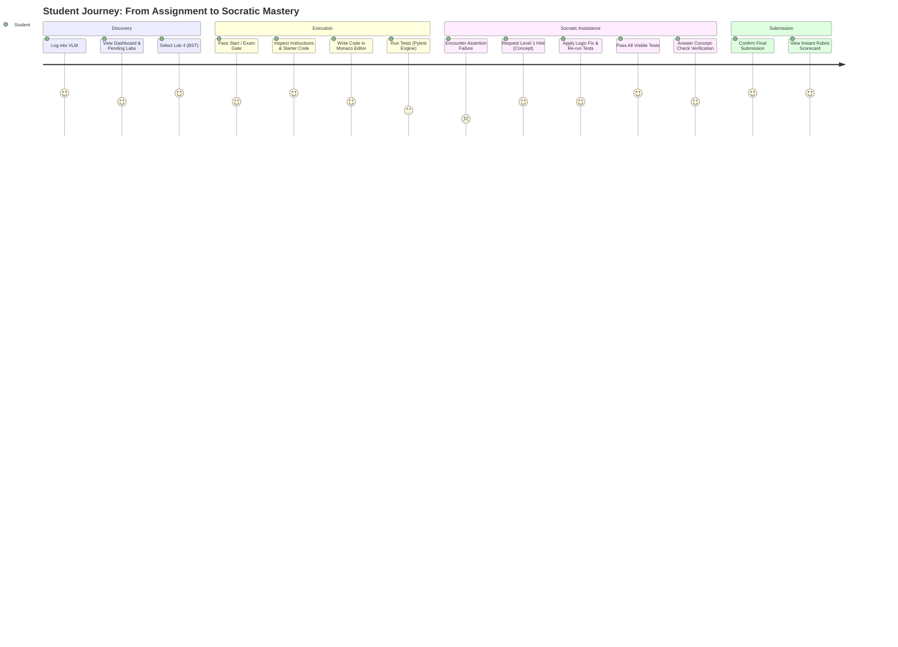
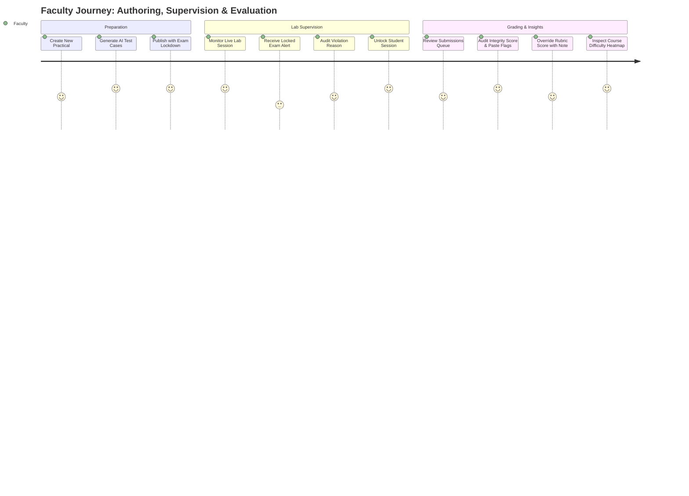

# Virtual Lab Manager (VLM) — Comprehensive UI/UX Product Design Specification
> **Document Version:** 2.0.0  
> **Status:** Approved Architecture & UI/UX Design Blueprint  
> **Target Audience:** Product Engineers, UI/UX Designers, Frontend Developers, Institutional Stakeholders  
> **Design Philosophy:** "Developer-First Academic SaaS" — High-density, zero-latency dark IDE for learners; clean, high-clarity executive light workspaces for educators and administrators.

---

## 1. Product Overview
**Virtual Lab Manager (VLM)** is an enterprise-grade academic laboratory operating system engineered specifically for engineering universities, technical colleges, and STEM educational institutions. It replaces physical computer laboratories, fragile hardware experimental setups, and manual evaluation workflows with an instant, zero-setup, browser-based virtual environment.

VLM natively unifies four heterogeneous engineering disciplines into a cohesive digital workspace:
1. **Software & Algorithm Engineering:** Browser-based Python IDE powered by Monaco, executing in isolated sandboxes with automated pytest-compatible unit testing.
2. **Digital Electronics & Logic Design:** Interactive circuit simulator (`circuit.sim`) supporting real-time signal propagation, truth table validation, interactive logic toggles, and live LED visualization.
3. **Data Science & Scientific Computing:** Interactive Jupyter-compatible notebooks (`data.ipynb`) executing step-by-step data analysis workflows with inline cell execution and rich output rendering.
4. **Engineering Mathematics & Virtual Physics/Electrical Benches:** Structured interactive worksheet labs (`answers.json`) featuring interactive virtual instruments (e.g., Simple Pendulum, DC Electrical Bench) and numerical algorithm visualizers (Newton-Raphson root finding, Simpson’s numerical integration).

Underpinning these workspaces is a specialized, multi-tiered AI engine powered by **Gemini 3.5 & Gemma**:
- **Socratic Lab Tutor:** A multi-turn, anti-spoiler cognitive assistant that provides progressive hints (conceptual nudge → edge-case focus → algorithmic logic) without ever leaking code fixes.
- **Automated Rubric Grader:** Objective, criterion-by-criterion evaluation that pairs automated test coverage with qualitative code inspection and actionable student feedback.
- **Behavioral & Code Academic Integrity Suite:** Continuous proctoring tracking typing cadence, burst velocities, clipboard events, tab switching, and AI code generation hallmarks.
- **Institutional Intelligence Engine:** Executive analytics for faculty and Heads of Department (HOD) that turn raw lab telemetry into early pacing alerts, deterministic student risk scores, and department-wide learning friction heatmaps.

---

## 2. Problem Statement
Higher education engineering programs globally, and across India’s 3,500+ technical institutions specifically, face systemic structural bottlenecks in lab-based education:
1. **Physical Lab Inefficiencies & Hardware Deficits:** Physical labs are capital-intensive, hardware is frequently obsolete or broken (burned resistors, loose breadboard wires, faulty microcontrollers), and labs are constrained by strict physical scheduling (typically 2 hours/week).
2. **Environment Configuration Fatigue:** Students spend 40% of lab time configuring compilers, dependencies, Python virtual environments, and path variables rather than mastering core computational thinking.
3. **The "Copy-Paste / AI Spoon-Feeding" Crisis:** With the proliferation of LLMs, students paste boilerplate code directly into assignments without cognitive friction, eroding problem-solving abilities and rendering traditional homework assignments ungradable.
4. **Faculty Grading Overload & Evaluation Lag:** Professors and teaching assistants spend 15–20 hours per week manually checking repetitive lab reports. Feedback loops take 2 to 3 weeks, by which point the pedagogical moment has passed.
5. **Institutional Blindspots:** Department Heads have zero real-time visibility into student struggles until mid-term exam failures. High-friction concepts (e.g., pointer manipulation, binary tree recursion, duplicate keys) remain invisible bottlenecks across cohorts.

---

## 3. Product Purpose
The primary purpose of Virtual Lab Manager is to democratize, standardize, and accelerate technical education by providing:
- **Instant Student Accessibility:** Zero-setup browser access to professional-grade engineering workspaces on any device, anywhere.
- **Pedagogical Integrity through Socratic AI:** An AI tutor that guides students to discover solutions themselves, enforcing genuine cognitive effort.
- **Instant Objective Assessment:** Real-time test assertion feedback combined with transparent rubric scorecards.
- **Institutional Governance & Fairness:** Strict exam lockdown security, academic integrity audits, and automated faculty workload optimization.
- **Data-Driven Curriculum Optimization:** Transforming granular student error logs into actionable institutional curriculum interventions.

---

## 4. Target Audience
VLM serves institutional technical education ecosystems comprising three core user tiers:
1. **Undergraduate & Postgraduate Students:** Enrolled in Computer Science, Electrical Engineering, Electronics & Telecommunications, Information Technology, and Applied Sciences courses.
2. **Course Instructors, Professors, & Lab Assistants:** Responsible for authoring practicals, supervising lab cohorts, grading submissions, and providing academic interventions.
3. **Academic Administrators (Heads of Department, Deans, Directors):** Responsible for faculty workload allocation, curriculum pacing, university compliance, exam integrity, and student retention.

---

## 5. User Personas

### Persona 1: The Struggling Student — Aarav Sharma (2nd Year B.Tech CSE)
- **Context:** Enrolled in *CS201: Data Structures & Algorithms*. Accesses labs on a mid-range personal laptop or college lab desktop with intermittent connectivity.
- **Pain Points:** Gets stuck on subtle edge cases (e.g., BST duplicate key insertion) and experiences debugging paralysis. When using ChatGPT, he gets full solutions that he doesn't understand and gets penalized for AI plagiarism.
- **Goals:** Understand *why* his code fails without being given the answer; get immediate test feedback; know his expected grade before final submission; avoid losing marks on formatting nits.
- **VLM Value:** Monaco-powered IDE with pytest checklists, auto-diff on assertion failure, and progressive Socratic hints that ask guiding questions.

### Persona 2: The Overworked Faculty Member — Prof. Meera Kulkarni (Associate Professor, Dept. of CSE)
- **Context:** Teaches two theory courses and three practical lab sections (180+ total students). Supervises 10 mandatory practicals per semester.
- **Pain Points:** Drowns in 1,800+ lab submissions each semester. Manually checking outputs on student screens during lab hours leaves no time for individualized mentoring. Suspects widespread code copying but lacks objective evidence.
- **Goals:** Instant automated grading against standardized rubrics; clear visibility into who copied code vs. who struggled honestly; live exam invigilation with one-click lockdown unlock; ability to rapidly generate customized test cases.
- **VLM Value:** Automated rubric scorecards with manual score overrides, Live Lab Monitor with lock-reason auditing, and automated teaching material generators.

### Persona 3: The Governance-Focused HOD — Dr. Rajesh Deshpande (Head of Department, CSE)
- **Context:** Oversees 24 faculty members, 800+ students, and 18 lab courses. Reports semester compliance and accreditation metrics (NBA / NAAC) to university leadership.
- **Pain Points:** Discovers that students are failing a subject only after end-semester exams; has no visibility into whether practicals are completed on schedule; handles disputes over subjective grading; manually compiles accreditation compliance spreadsheets.
- **Goals:** Real-time dashboard showing department lab completion %; automated early-warning identification of at-risk students; clear curriculum difficulty heatmaps; one-click export of compliance reports.
- **VLM Value:** Executive KPI dashboards, automated weekly AI briefings, conversational natural language queries on department telemetry, and single-click CSV compliance audits.

---

## 6. Core Use Cases (P0)

### UC-101: Student Lab Execution & Self-Correction
- **Target User:** Student
- **User Problem:** Cannot tell whether code meets assignment criteria prior to grading.
- **Starting Point:** Student Dashboard → Course → Select Lab.
- **Workflow:**
  1. Student reads lab objectives, constraints, and visible test specifications.
  2. Types code into Monaco editor or adjusts logic in interactive circuit simulator.
  3. Clicks **Run Tests (`⌘↵` / `Ctrl+Enter`)**.
  4. Backend sandbox executes code against test assertions in < 800ms.
  5. UI displays pytest-style pass/fail terminal with auto-expanded expected vs. actual diffs.
- **Expected Output:** Instant visual status pill (`4/5 tests passing`) and actionable error diagnostics.
- **Key Dependencies:** Sandbox Execution Engine, Monaco Editor, Pytest Adapter.

### UC-102: Socratic AI Lab Tutoring
- **Target User:** Student
- **User Problem:** Student is stuck on a failing test but wants guidance, not a spoon-fed solution.
- **Starting Point:** Lab Workspace → Right Drawer → "Ask Tutor" or "Hint" button.
- **Workflow:**
  1. System checks current test failure context and current code snapshot.
  2. Level 1 Hint delivers a conceptual nudge explaining the underlying CS theory.
  3. If student remains stuck, Level 2 identifies the divergence branch/function.
  4. Level 3 outlines algorithmic steps in plain English (strictly zero code blocks).
  5. If student passes all visible tests, Tutor poses a Concept-Check verification question.
- **Expected Output:** Multi-turn dialogue with zero copy-pasteable answers and strict prompt injection guards.
- **Key Dependencies:** Gemini Socratic Prompt Engine, Tutor Guard, Anti-Canary Leak Detection.

### UC-103: Formal Lab Submission & Rubric Evaluation
- **Target User:** Student
- **User Problem:** Uncertainty over how qualitative and quantitative criteria are weighed.
- **Starting Point:** Lab Workspace Header → Primary CTA: **Submit**.
- **Workflow:**
  1. Student clicks Submit. System validates that at least one test run was attempted.
  2. Dialog warns student of hidden test execution and unchangeable submission state.
  3. Final code submitted to Rubric Grader: runs visible + hidden tests, inspects structure.
  4. Scorecard modal displays final score ring (e.g. `9.5/10.0`), rubric criteria breakdown, and encouraging feedback summary.
- **Expected Output:** Persistent `SubmissionRecord` with permanent timestamp and rubric breakdown.
- **Key Dependencies:** Rubric Grader Engine, Hidden Test Runner.

### UC-104: Faculty Practical Authoring & Test Generation
- **Target User:** Faculty
- **User Problem:** Writing starter files, solution implementations, and unit test suites takes hours.
- **Starting Point:** Faculty Dashboard → **+ New Practical**.
- **Workflow:**
  1. Instructor selects course, lab type (coding/circuit/notebook/worksheet), title, and max score.
  2. Uses built-in templates or enters a topic prompt into **AI Test Generator**.
  3. AI generates Python assert statements with boundary conditions and automatically designates 2 hidden test cases.
  4. Instructor tests solution against authoring sandbox using **Validate**.
  5. Sets lockdown mode (`Off`, `Strict Exam Mode`, or `Safe Exam Browser`) and clicks **Publish**.
- **Expected Output:** Live published practical enrolled to all cohort students.
- **Key Dependencies:** AI Testgen Service, Validation Sandbox, Course Registry.

### UC-105: Live Lab Exam Lockdown & Remote Proctor Invigilation
- **Target User:** Faculty & Student
- **User Problem:** Preventing digital cheating, unauthorized collaboration, and tab switching during exams.
- **Starting Point:** Student opens lockdown practical; Faculty opens Live Lab Monitor.
- **Workflow:**
  1. Student encounters fullscreen **Exam Gate**. Must acknowledge exam rules.
  2. Fullscreen enforced; devtools, clipboard paste, tab blur, and multi-window access are blocked.
  3. If student attempts violation (e.g., switches window), workspace locks immediately with reason logged.
  4. Faculty sees row turn rose (`Locked: Tab blur`) on **Live Lab Monitor**.
  5. Student requests mentor assistance; Faculty clicks **Unlock** with required audit note.
  6. Student clicks **Resume Exam** to re-enter fullscreen workspace.
- **Expected Output:** Real-time synchronized exam state with zero client-side bypasses.
- **Key Dependencies:** Exam State Machine, WebSocket / Polling Heartbeat, Proctor Telemetry.

---

## 7. Secondary Use Cases (P1)

### UC-201: Faculty Manual Score & Feedback Override
- **Target User:** Faculty
- **User Problem:** AI rubric assigned 8/10, but instructor wants to reward an exceptionally novel algorithm or penalize formatting.
- **Workflow:** Faculty opens submission detail view → views AI rubric breakdown and code diff → types manual score and instructor comment → clicks **Save Review**.

### UC-202: Academic Integrity Audit Inspection
- **Target User:** Faculty / HOD
- **User Problem:** Verify whether a student's high score was achieved honestly or through external AI paste.
- **Workflow:** Review Submission → click **Integrity Badge** → view typing cadence (burst characters per second), baseline file divergence, large insertion diffs, and AI syntax style indicators.

### UC-203: Interactive Circuit Simulation & Truth Table Verification
- **Target User:** Student (Electronics / CS)
- **User Problem:** Breadboarding logic gates physically is error-prone and tedious.
- **Workflow:** Student opens `circuit.sim` → edits netlist declarations → clicks **Simulate** → toggles live input switches → observes LED output states and interactive timing diagrams.

### UC-204: Worksheet Virtual Instrument & Curve Fitting
- **Target User:** Student (Physics / Electrical)
- **User Problem:** Recording manual instrument readings into physical journals.
- **Workflow:** Student runs Simple Pendulum or DC Bench virtual apparatus → takes measurements recorded directly into read-only observation table columns → inputs calculations into step cells → UI renders real-time scatter graph with least-squares linear regression fit.

---

## 8. Advanced Use Cases (P2)

### UC-301: HOD Conversational Department Analytics ("Ask AI")
- **Target User:** HOD
- **User Problem:** Finding specific cross-course data (e.g., "Which faculty member has the longest grading turnaround this month?") requires complex SQL queries.
- **Workflow:** HOD Dashboard → **Ask** tab → types question in plain natural language → Gemini Analyst processes sanitized JSON telemetry snapshot → returns direct answers, highlighted bullet insights, and formatted comparison tables.

### UC-302: Institutional Pacing & Bottleneck Heatmap Analysis
- **Target User:** HOD / Faculty
- **User Problem:** Identifying curriculum bottlenecks before students fail end-semester exams.
- **Workflow:** HOD/Faculty opens **Intelligence** tab → inspects **Learning Difficulty Heatmap** sorted by failure rate and affected students → identifies that `test_duplicate_keys` in BST has a 72% failure rate → schedules a departmental remedial session.

### UC-303: Deterministic At-Risk Student Identification & Follow-up
- **Target User:** Faculty / HOD
- **User Problem:** Identifying students disengaging before they drop out.
- **Workflow:** Intelligence Tab → **At-Risk Students** → view students ranked by deterministic risk score (low completion %, low score, overdue count, repeated stagnant attempts) → click **Reasons** → review specific failure factors and recommended intervention steps.

---

## 9. User Journey Maps

### Journey 1: Student End-to-End Lab Experience


### Journey 2: Faculty Lab Administration & Evaluation


---

## 10. Information Architecture & Navigation

The platform enforces strict role-based separation:
- A user session represents exactly **one person in one role** (no role-switching dropdowns inside active views).
- Navigating between views adheres to zero-layout-shift principles with consistent top navigation bars.

```
Virtual Lab Manager
├── / (Public Auth & Landing)
│   ├── Login Form (Email + Password)
│   └── One-Click Demo Role Cards (Student / Faculty / HOD)
│
├── /student (Student Workspace)
│   ├── /student (Dashboard: My Labs, Course Progress, To Do / Completed)
│   ├── /student/courses/[id] (Filtered Course Lab View)
│   └── /student/labs/[id] (Zero-Distraction IDE Workspace)
│       ├── Header (Status Pill, Proctor Chip, Timer/Pause, Run/Hint/Submit)
│       ├── Left Pane (Instructions / Multi-Tab Code / Notebook / Worksheet)
│       └── Right Pane (Test Runner Terminal, Socratic Hint Stepper, Rubric Panel)
│
├── /faculty (Faculty Command Center)
│   ├── /faculty (Dashboard Tabs: Practicals, Submissions, Insights, Intelligence, Courses)
│   ├── /faculty/practicals/new (Authoring Wizard & AI Test Generator)
│   ├── /faculty/practicals/[id]/edit (Practical Configuration & Lockdown Settings)
│   ├── /faculty/practicals/[id]/submissions (Cohort Submissions Table)
│   ├── /faculty/practicals/[id]/monitor (Live Lab Exam Monitor & Invigilation)
│   ├── /faculty/submissions/[id] (Submission Evaluation, Diff & Proctor Timeline)
│   └── /faculty/teaching (AI Teaching Material & Viva Question Generator)
│
└── /hod (Department Executive Suite)
    └── /hod (Executive Tabs: Overview, AI Insights, Intelligence, Courses & Faculty, Compliance, Ask AI)
```

---

## 11. Sitemap & Navigation Structure

### Global Header Specifications
- **Height:** Exactly `56px` (`h-14`).
- **Background:** `bg-slate-950` with bottom border `border-slate-800`.
- **Left Elements:** Monospace Brand Mark (`VLM` / `Virtual Lab Manager`), Active Role Badge (`Student` / `Faculty` / `HOD`).
- **Center Elements (Faculty & HOD):** Breadcrumb context (`CS201 › Lab 4: Binary Search Trees`).
- **Right Elements:**
  - `AlertsBell` (Faculty/HOD only: polls `/faculty/alerts` every 10s; pulsing red count pill).
  - User Identity display (`Prof. Meera Kulkarni`).
  - **Sign Out** button (clears session and returns to `/`).

---

## 12. Recommended Design Direction: "Developer-First Academic SaaS"

### Why This Visual Direction?
Traditional learning management systems (e.g., Moodle, Blackboard) fail because they look like bureaucratic administrative databases. Conversely, generic modern SaaS templates look like marketing dashboards with frivolous decorative cards and empty whitespace.

VLM implements a deliberate **Dual-Mode Architectural Aesthetic**:
1. **The Student Workspace is Dark (`#0a0b0f` canvas):** Modeled after high-focus developer environments like **Linear**, **Vercel**, and **Replit**. Dark canvas minimizes ocular strain during 2-hour lab sessions, treats code and terminal outputs as first-class citizens, and maximizes editor real estate.
2. **The Faculty & HOD Dashboards are Light (`#f8fafc` slate-50):** Modeled after high-clarity data tools like **Stripe Dashboard** and **Raycast for Teams**. Crisp white cards, razor-thin hairlines, and tabular metrics allow educators to rapidly scan tables with hundreds of student records without visual fatigue.

---

## 13. Brand Identity & Visual Language
- **Brand Voice:** Objective, technical, academic, precise, encouraging.
- **Tone:** Zero marketing fluff. Sentence-case headers. Numerical precision (`4/5 tests passed`, never "Almost there!").
- **Visual Stance:** Zero decorative illustrations, zero floating 3D icons, zero unnecessary animations. Every pixel communicates functional state.

---

## 14. Color System

### Workspace Dark Palette (Student IDE)
| Token | Hex Value | Role & Usage |
|:---|:---|:---|
| `canvas` | `#0a0b0f` | Main IDE root canvas, terminal background |
| `surface-1` | `#0f1117` | Secondary panes, Monaco editor gutter & background |
| `surface-2` | `#151821` | Active tab headers, cards, popover containers |
| `surface-3` | `#1c202b` | Segmented controls, input fields, hover states |
| `line` | `rgba(255,255,255,0.06)` | 1px hairline structural borders |
| `line-strong`| `rgba(255,255,255,0.12)` | Active control borders, divider rules |
| `fg` | `#e6e8ee` | Primary readable prose, code text |
| `fg-muted` | `#9aa3b2` | Secondary metadata, labels, status text |
| `fg-faint` | `#6b7280` | Placeholder text, line numbers, disabled states |
| `brand` | `#6366f1` | Primary CTA buttons, active tab indicators, focus rings |

### Dashboard Light Palette (Faculty & HOD)
| Token | Hex Value | Role & Usage |
|:---|:---|:---|
| `bg-page` | `#f8fafc` (`slate-50`) | Full page background |
| `bg-card` | `#ffffff` (`white`) | Container cards, modal panels, table wrappers |
| `border-card`| `#e2e8f0` (`slate-200`)| 1px crisp structural card borders |
| `text-primary`| `#0f172a` (`slate-900`)| Headings, student names, primary scores |
| `text-secondary`| `#475569` (`slate-600`)| Descriptive labels, secondary metrics |
| `text-muted` | `#64748b` (`slate-500`)| Table column headers, timestamps, meta hints |

### Semantic State System (Shared)
| Status | Dark Pill Class | Light Badge Class | Usage |
|:---|:---|:---|:---|
| **Pass / Success** | `bg-emerald-500/10 text-emerald-300 ring-emerald-500/20` | `bg-emerald-50 text-emerald-700 ring-emerald-600/20` | Tests passing, compliant, unlocked |
| **Warning / Pacing**| `bg-amber-500/10 text-amber-300 ring-amber-500/20` | `bg-amber-50 text-amber-700 ring-amber-600/20` | Pacing gap, medium integrity risk, due soon |
| **Fail / Critical** | `bg-rose-500/10 text-rose-300 ring-rose-500/20` | `bg-rose-50 text-rose-700 ring-rose-600/20` | Failed test assertion, exam locked, high risk |
| **AI / Socratic** | `bg-purple-500/10 text-purple-300 ring-purple-500/20` | `bg-purple-50 text-purple-700 ring-purple-600/20` | Socratic tutor turn, AI grading summary |
| **Neutral / Todo** | `bg-white/5 text-slate-400 ring-white/10` | `bg-slate-100 text-slate-700 ring-slate-200` | Unattempted practical, draft status |

---

## 15. Typography System
- **UI Font Family:** `Inter`, `-apple-system, BlinkMacSystemFont, "Segoe UI", sans-serif`.
- **Code & Numeric Font Family:** `JetBrains Mono`, `ui-monospace, SFMono-Regular, Menlo, monospace`. (Font ligatures enabled for `!=`, `==`, `->`, `<=`).

### Hierarchy & Scale
| Level | Font Size | Line Height | Weight | Font Class | Usage |
|:---|:---|:---|:---|:---|:---|
| **Display Score**| `30px` (`1.875rem`) | `36px` | `700 Bold` | `font-mono tabular-nums` | Scorecard modal rings, big KPI metrics |
| **Page Title** | `24px` (`1.5rem`) | `32px` | `600 SemiBold` | `font-sans` | Top level page headers (`My Labs`, `Faculty Dashboard`) |
| **Section Title**| `18px` (`1.125rem`) | `28px` | `600 SemiBold` | `font-sans` | Card headers, modal headings |
| **Body Regular** | `14px` (`0.875rem`) | `20px` | `400 Regular` | `font-sans` | Standard instructional prose, descriptions |
| **Body Medium** | `14px` (`0.875rem`) | `20px` | `500 Medium` | `font-sans` | Table cell contents, button text |
| **Caption / Meta**| `12px` (`0.75rem`) | `16px` | `500 Medium` | `font-sans` | Table column headers, timestamps, helper text |
| **Code / Logs** | `13px` (`0.8125rem`)| `18px` | `400 Regular` | `font-mono` | Monaco editor buffer, terminal error tracebacks |

---

## 16. Spacing, Grid & Layout Systems
- **Base Grid:** `4px` baseline (`0.25rem`).
- **Component Padding Scale:**
  - Micro buttons / pills: `px-2 py-1`
  - Standard buttons / inputs: `px-3.5 py-2` (height: `36px`)
  - Cards: `p-5` (`20px` interior padding)
  - Layout gaps: `gap-4` (`16px`) on mobile, `gap-6` (`24px`) on desktop
- **Max Container Width:** `max-w-7xl` (`1280px`) centered with `mx-auto px-4 sm:px-6 lg:px-8`.
- **Workspace Bounds:** Exactly `100dvh` viewport lock with zero body scrollbar (`overflow-hidden`).

---

## 17. Component Design System Specification

### 17.1 Buttons (`<Button>`, `<LinkButton>`)
- **Primary:** `bg-indigo-600 hover:bg-indigo-500 text-white font-medium rounded-md shadow-sm`. Exactly one primary button per screen.
- **Secondary:** `bg-white hover:bg-slate-50 text-slate-700 border border-slate-300 rounded-md`.
- **Ghost:** `hover:bg-slate-100 text-slate-600 rounded-md`.
- **Destructive:** `bg-rose-600 hover:bg-rose-500 text-white rounded-md`.
- **Loading State:** Disabled, text remains visible with `Loader2` spinner prepended.

### 17.2 Cards & Containers (`<Card>`, `<CardHeader>`)
- High-clarity white containers: `bg-white border border-slate-200 rounded-lg shadow-sm`.
- Header rule: `CardHeader` includes title (`text-sm font-semibold text-slate-900`), optional subtitle, and right-aligned filter action slots.

### 17.3 Data Tables
- Header: `border-b border-slate-100 bg-slate-50/50 text-xs font-medium text-slate-500 uppercase tracking-wider`.
- Row: `border-b border-slate-100 hover:bg-slate-50/60 transition-colors py-3`.
- Numerical Alignment: All score, date, and count columns use `text-right font-mono tabular-nums`.

### 17.4 Stat Tile (`<StatTile>`)
- Structure: Subdued top label (`text-xs font-medium text-slate-500`), large numerical display (`text-2xl font-semibold text-slate-900 font-mono`), and bottom context label (`text-xs text-slate-400`).
- Strict rule: No decorative background icons.

---

## 18. Page-by-Page UI Blueprint & Specifications

### 18.1 Landing & Unified Authentication (`/`)
- **Target User:** Student, Faculty, HOD.
- **Purpose:** Secure institutional gateway and one-click demo login.
- **Main Elements:**
  - Dark ambient backdrop (`bg-slate-950`).
  - Centered auth container (`max-w-md`) with glowing blur backdrops.
  - One-Click Role Cards: Three distinct role cards for instant zero-password judging access.
  - Standard Credentials Form: Institutional email and password input fields with inline validation.

#### Text Wireframe: Landing / Login
```
+-----------------------------------------------------------------------+
|                             [VLM Logo]                                |
|                        Virtual Lab Manager                            |
|     Interactive Engineering Labs, Socratic AI & Rubric Evaluation     |
+-----------------------------------------------------------------------+
|  +-----------------------------------------------------------------+  |
|  | ONE-CLICK DEMO ACCESS                                           |  |
|  | [🎓 Student ] Aarav Sharma   · BST Lab, Hints & Submit    [Enter]|  |
|  | [🧑‍🏫 Faculty ] Meera Kulkarni · Grading, Monitor & Tests    [Enter]|  |
|  | [🏛️ HOD     ] Dr. Deshpande  · Department Intelligence    [Enter]|  |
|  +-----------------------------------------------------------------+  |
|  | OR SIGN IN WITH INSTITUTIONAL CREDENTIALS                       |  |
|  | Email:    [ student@college.edu                               ] |  |
|  | Password: [ ••••••••••••••••                                  ] |  |
|  |           [        Sign In to Portal        ]                   |  |
|  +-----------------------------------------------------------------+  |
+-----------------------------------------------------------------------+
```

---

### 18.2 Student Dashboard (`/student`)
- **Target User:** Student.
- **Purpose:** Cohort overview, lab deadlines, progress tracking across courses.
- **Header:** PageHeader with Roll Number badge, Course Tabs filter.
- **KPI Tiles:** Labs completed (`X/Y`), Average score (`X/10.0`), Hints used.
- **Main Sections:**
  - Course Cards Grid: Visual progress rings per enrolled subject.
  - All Labs Split Table: Two clean tabs — **To Do** (due dates highlighted with late warning) vs. **Completed** (final scores and feedback links).

#### Text Wireframe: Student Dashboard
```
+-----------------------------------------------------------------------+
| VLM  Virtual Lab Manager      [Alerts]   Aarav Sharma (CS21B042) [Out]|
+-----------------------------------------------------------------------+
| [All Courses] [CS201 Data Structures] [EE210 Digital Logic]          |
|                                                                       |
| My Labs  [Student Badge]                                              |
| CS21B042 · 3 Enrolled Courses                                         |
|                                                                       |
| +-------------------+  +-------------------+  +--------------------+  |
| | Labs Completed    |  | Average Score     |  | Hints Used         |  |
| | 7 / 10 (70%)      |  | 8.8 / 10.0        |  | 14 Hints           |  |
| +-------------------+  +-------------------+  +--------------------+  |
|                                                                       |
| ENROLLED COURSES                                                      |
| +-------------------------------+   +-------------------------------+ |
| | CS201 Data Structures Lab     |   | EE210 Digital Electronics Lab | |
| | 4/5 Labs Done · Avg: 9.1/10   |   | 3/4 Labs Done · Avg: 8.4/10   | |
| +-------------------------------+   +-------------------------------+ |
|                                                                       |
| ALL LAB PRACTICALS                                                    |
| [To Do (3)]   [Completed (7)]                                         |
| +-------------------------------------------------------------------+ |
| | Lab 4: Binary Search Trees | Due in 2d | Exam Mode | [Start Lab]  | |
| | Lab 5: Graph BFS Traversal | Due in 6d | Proctored | [Start Lab]  | |
| +-------------------------------------------------------------------+ |
+-----------------------------------------------------------------------+
```

---

### 18.3 Student Lab Workspace (`/student/labs/[id]`)
- **Target User:** Student.
- **Purpose:** Core execution IDE. Zero distractions, zero layout shift, maximum focus.
- **Structure:**
  - **Header (`56px`):** Back breadcrumb, Lab Title, Live Status Pill (`4/5 tests passing`), Proctor Status Chip, Timer/Pause (exam mode), Action CTAs: `Run Code`, `Run Tests (⌘↵)`, `Ask Tutor`, `Submit`.
  - **Left Pane (55% width):** File tabs (`Instructions`, `main.py`, `circuit.sim`, `data.ipynb`, `worksheet`). Embedded Monaco Editor with JetBrains Mono font. Status bar at bottom showing Gemma lint diagnostics and runtime latency.
  - **Right Pane (45% width):**
    - Top: Pytest Terminal Output with colored assertions and visual diff on mismatch.
    - Bottom: Tabbed Drawer with **Socratic AI Tutor** conversation and **Rubric Breakdown**.

#### Text Wireframe: Student Lab Workspace
```
+-----------------------------------------------------------------------+
| ← CS201 › Lab 4: BST   [● 4/5 Passing] [Shield: Proctored] [Submit]   |
| Actions: [Run Code] [Run Tests ⌘↵] [Ask Tutor]                        |
+------------------------------------+----------------------------------+
| [Instructions] [main.py*]          | TEST RUNNER (pytest)             |
| 1  class BSTNode:                  | ✓ test_empty_tree_init     PASSED|
| 2      def __init__(self, key):    | ✓ test_single_insert       PASSED|
| 3          self.key = key          | ✗ test_duplicate_keys      FAILED|
| 4          self.left = None        |   AssertionError: expected size 3|
| 5          self.right = None       |   Actual: 4                      |
| 6                                  |----------------------------------|
| 7      def insert(self, key):      | SOCRATIC AI TUTOR    [Rubric]    |
| 8          if key < self.key:      | Tutor: What should happen to a   |
| 9              ...                 | node's size when inserting an    |
|                                    | identical duplicate key?         |
| [Ln 8, Col 14] [Gemma: Clean]      | [ Type question to tutor... ]    |
+------------------------------------+----------------------------------+
```

---

### 18.4 Faculty Dashboard & Command Center (`/faculty`)
- **Target User:** Course Instructor.
- **Purpose:** Manage practicals, review auto-graded submissions, inspect cohort intelligence.
- **Navigation Tabs:** `Practicals`, `Submissions`, `Where Students Struggle`, `Intelligence`, `Courses`.
- **Top Actions:** `+ New Practical`, `Generate Teaching Material`.
- **Key Cards:**
  - Workload KPI Tiles (Pending reviews, Oldest pending submission age).
  - Submissions Queue with one-click **Review** links.
  - Intelligence Module: Performance distribution, workload, completion bars, at-risk students, difficulty heatmap.

#### Text Wireframe: Faculty Dashboard
```
+-----------------------------------------------------------------------+
| VLM  Virtual Lab Manager       [Alerts (2)]   Prof. Kulkarni    [Out] |
+-----------------------------------------------------------------------+
| Faculty Dashboard  [Faculty Badge]              [+ New Practical]     |
| Manage practicals, review submissions & analyze cohort intelligence   |
|                                                                       |
| [Practicals (6)] [Submissions (48)] [Intelligence] [Courses (2)]      |
|                                                                       |
| +-------------------+  +-------------------+  +--------------------+  |
| | Active Practicals |  | Pending Review    |  | Average Turnaround |  |
| | 6 Published       |  | 8 Submissions     |  | 1.2 Days           |  |
| +-------------------+  +-------------------+  +--------------------+  |
|                                                                       |
| INTELLIGENCE & COHORT FRICTION                                        |
| +-------------------------------------------------------------------+ |
| | AT-RISK STUDENTS IN YOUR COURSES                                  | |
| | • Rohit Verma (Roll 104) | Risk: 85 (High) | 2 Overdue labs       | |
| | • Sneha Patil (Roll 112) | Risk: 65 (High) | Low test avg (38%)   | |
| +-------------------------------------------------------------------+ |
| | TOP BOTTLENECKS (DIFFICULTY HEATMAP)                              | |
| | • test_duplicate_keys    | CS201 Lab 4 | 72% Fail Rate | 34 Hints | |
| | • test_reversal_pointers | CS201 Lab 2 | 58% Fail Rate | 19 Hints | |
| +-------------------------------------------------------------------+ |
+-----------------------------------------------------------------------+
```

---

### 18.5 Live Lab Exam Monitor (`/faculty/practicals/[id]/monitor`)
- **Target User:** Faculty Invigilator.
- **Purpose:** Real-time exam supervision, lockdown auditing, and mentor unlocks.
- **KPI Status Tiles:** `Online (42)`, `Active (38)`, `Locked (2)`, `Submitted (4)`.
- **Student Exam Table:**
  - Student Name & Roll Number.
  - Live Exam State (`Active`, `Locked`, `Paused`, `Submitted`).
  - Lock Reason with timestamp (`Fullscreen exit`, `Tab blur`, `Devtools open`).
  - Live Proctor Violations counter (Paste attempts, away time in ms).
  - Action CTA: **Unlock** button with required mentor verification note.

---

### 18.6 HOD Executive Suite (`/hod`)
- **Target User:** Head of Department.
- **Purpose:** Department governance, cross-faculty workload distribution, accreditation reporting.
- **Tabs:** `Overview`, `AI Insights`, `Intelligence`, `Courses & Faculty`, `Compliance`, `Ask AI`.
- **Key Modules:**
  - Department Activity 14-day trend charts (Executions, Submissions, AI Hints).
  - Faculty Workload Matrix with automated **"High load"** flags (>2x department average).
  - Weekly Executive Briefing card generated automatically by Gemini.
  - Conversational **Ask AI** terminal for direct natural language queries.
  - One-Click **Export Compliance CSV** for NBA/NAAC auditing.

---

## 19. Interaction Design & Micro-Interaction Guidelines

### 19.1 Keyboard Shortcuts
- `⌘ + Enter` / `Ctrl + Enter`: Trigger **Run Tests** in student workspace.
- `⌘ + S` / `Ctrl + S`: Force immediate draft sync to server (overriding 2-second debounce).
- `Escape`: Close modals, dismiss popovers, or cancel full-screen dialogs.

### 19.2 Loading & Transition Principles
- **No Layout Shift:** Every container, stat tile, and table column has an explicit pre-allocated width or minimum height.
- **Skeleton Shimmers:** Skeletons match the exact geometric dimensions of the loaded content (`DarkSkeleton` in workspace, light skeleton on dashboards).
- **Tab Transitions:** Instantaneous tab switching using zero-overhead state swaps (no sliding animations that delay user interaction).

---

## 20. Responsive Design Guidelines

| Breakpoint | Width Range | Layout Adaptation |
|:---|:---|:---|
| **Mobile (`sm`)** | `< 640px` | Single-column stack. Lab workspace shifts to segmented switch (`Editor` vs `Results/Terminal`). Top nav collapses brand text. |
| **Tablet (`md`)** | `640px – 1023px` | Two-column dashboard grids. Table horizontal scrolling enabled with fixed sticky left column. |
| **Desktop (`lg+`)** | `≥ 1024px` | Full dual-pane fixed-fraction workspace (55% Editor, 45% Results). 4-column stat tile grids. |

---

## 21. Accessibility Specification (WCAG 2.2 AA)
- **Contrast Ratios:**
  - Prose text against dark canvas: `14.2:1` (exceeds AAA requirement).
  - Prose text on light dashboard: `12.6:1`.
  - Semantic pills: Minimum `4.8:1` text-to-pill-background contrast.
- **Focus Rings:** High-visibility 2px solid `#6366f1` ring with 2px offset on all interactive buttons, selects, and text inputs.
- **Screen Reader Semantics:**
  - All icon-only buttons carry mandatory `aria-label` attributes.
  - Test runner outputs are tagged with `role="region"` and `aria-live="polite"` so results are announced upon test suite completion.
- **Tab Navigation:** Logical tab sequences across editor, terminal, hint stepper, and submit controls.

---

## 22. Error Handling & Edge Cases

| Scenario | System Behavior | UI Feedback |
|:---|:---|:---|
| **Compilation / Syntax Error** | Sandbox captures stderr without crashing | Terminal renders formatted stderr traceback with exact line pointers; Gemma linter underlines offending syntax. |
| **Infinite Loop / Timeout** | Sandbox enforces strict 5000ms wall-clock timeout | Terminal displays amber warning badge: `Timeout Error (exceeded 5.0s). Check while loop exit conditions.` |
| **Network Disconnection** | LocalStorage caches code keystrokes | Header shows amber indicator: `Working offline · Changes saved locally`. Auto-syncs upon reconnect. |
| **Exam Window Blur** | Client triggers heartbeat violation event | Workspace locks immediately. Shows `ExamLockOverlay` with reason and pulsing mentor unlock indicator. |
| **AI Rate Limit / Outage** | Service falls back gracefully to rule-based engine | Socratic hints fall back to rule-based unit test failure inspection; banner notes `Fallback Hint Engine Active`. |

---

## 23. Product Differentiation Opportunities

1. **Anti-Cheating Socratic Guardrails:** Unlike generic ChatGPT wrappers, VLM's multi-layered tutor guard guarantees that students cannot coax the AI into outputting copy-pasteable code solutions.
2. **True Multidisciplinary Engineering Support:** Unifies Computer Science (Python/Monaco), Electronics (Logic Circuit Simulator), Data Science (Jupyter Notebooks), and Applied Sciences (Virtual Instrument Worksheets) under one unified operating system.
3. **Deterministic Institutional Intelligence:** Risk scores and pacing flags are 100% explainable and deterministic (no hallucinated AI flags), giving department chairs justifiable metrics for academic interventions.
4. **Zero-Setup Client Execution:** Complete freedom from local environment configuration friction, leveling the playing field for students with entry-level laptops.
5. **Integrated Exam Proctoring with SEB Support:** High-stakes exam capabilities built right into the platform, avoiding expensive third-party invigilation software licenses.

---

## 24. Technical Implementation Recommendations

### Architecture Mapping
- **Frontend Framework:** `Next.js 16` (App Router) + `React 19` + `Tailwind CSS 4`.
- **Editor:** `@monaco-editor/react` (configured with `vlm-dark` custom theme and JetBrains Mono).
- **Backend API:** `FastAPI` (Python 3.12 ASGI) with Pydantic v2 domain schemas.
- **AI Gateway:** `google-genai` SDK targeting `gemini-2.5-flash` / `gemini-2.5-pro` with localized rule fallback adapters.
- **Database:** Unified repository interface supporting PostgreSQL (AlloyDB / Cloud SQL / Supabase) and Firestore.

---

## 25. Existing Components to Reuse (Zero Redundancy)

| Existing Component | Location | Reusable Capability |
|:---|:---|:---|
| `Card`, `CardHeader` | `frontend/src/components/ui.tsx` | Standard light container frames |
| `StatTile` | `frontend/src/components/ui.tsx` | Metric display tiles |
| `UnderlineTabs` | `frontend/src/components/ui.tsx` | Accessible dashboard section switching |
| `ScoreBar` | `frontend/src/components/ui.tsx` | Visual progress bars |
| `PerformanceCard` | `frontend/src/components/intelligence.tsx` | Score distribution and rubric metrics |
| `WorkloadCard` | `frontend/src/components/intelligence.tsx` | Faculty workload and turnaround stats |
| `CompletionCard` | `frontend/src/components/intelligence.tsx` | Pacing gap and completion tracking |
| `AtRiskCard` | `frontend/src/components/intelligence.tsx` | Risk factors and intervention actions |
| `HeatmapCard` | `frontend/src/components/intelligence.tsx` | Friction points and failing assertions |
| `TestRunnerTerminal`| `frontend/src/components/workspace/TestRunnerTerminal.tsx` | Pytest-style assertion output |
| `MultiTabEditor` | `frontend/src/components/workspace/MultiTabEditor.tsx` | Monaco editor tab manager |
| `TutorChat` | `frontend/src/components/workspace/TutorChat.tsx` | Multi-turn Socratic conversation pane |

---

## 26. Implementation Roadmap

### Phase 1: Core Foundation & Bug Polish (Current State — Complete)
- [x] Monaco code execution with Pytest assertions.
- [x] Socratic AI Tutor with prompt injection guards.
- [x] Live Lab Exam Lockdown and Proctoring engine.
- [x] Full Student & Faculty Intelligence Module (5 features for Faculty & HOD).

### Phase 2: Enhanced Visual Ergonomics (Next Phase)
- [ ] Implement split-pane drag resizing between Monaco editor and test runner terminal using CSS `resize` or lightweight pointer handlers.
- [ ] Add student submission revision history viewer (allowing students to inspect previous graded attempts side-by-side).
- [ ] Introduce dark/light theme toggle for faculty dashboard (while keeping student lab workspace strictly dark).

### Phase 3: Enterprise Accreditation & Mobile Companion
- [ ] Automated PDF accreditation dossier generation for NBA / NAAC compliance committee audits.
- [ ] Faculty mobile companion PWA for real-time exam lockdown unlock approvals from a smartphone.

---

## 27. Assumptions & Open Questions

### Confirmed Functionality
- Purely deterministic risk scoring for at-risk students (zero AI hallucinations).
- Socratic AI tutor never emits copy-pasteable code blocks > 1 line.
- Exam lockdown strictly enforces single-tab and fullscreen execution.

### Documented Assumptions
- Student workstations support modern evergreen browsers (Chrome, Edge, Firefox, Safari) with WebAssembly and Web Worker support.
- Institutions utilize standard grading scales (0 to 10 points) compatible with the rubric criteria engine.

### Open Questions for Institutional Deployments
- *LMS Integration:* Does the institution require LTI 1.3 integration (Canvas, Blackboard, Moodle) for automated roster and gradebook synchronization?
- *Execution Sandbox:* For high-scale on-premise deployments, will the institution run the local subprocess runner or deploy dedicated Judge0 / Docker sandbox clusters?
